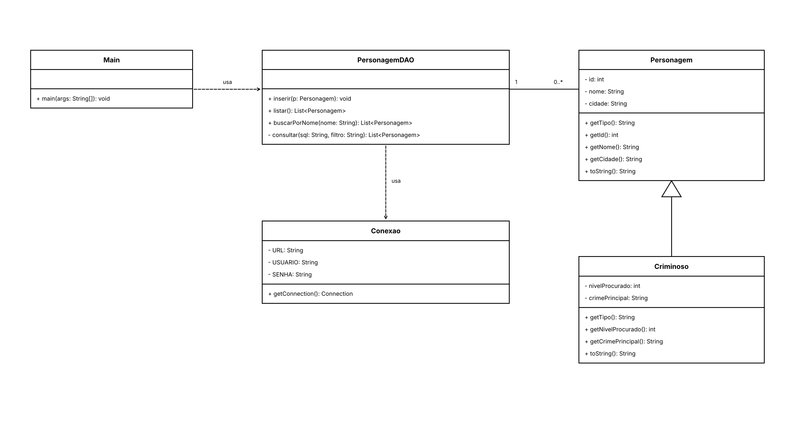
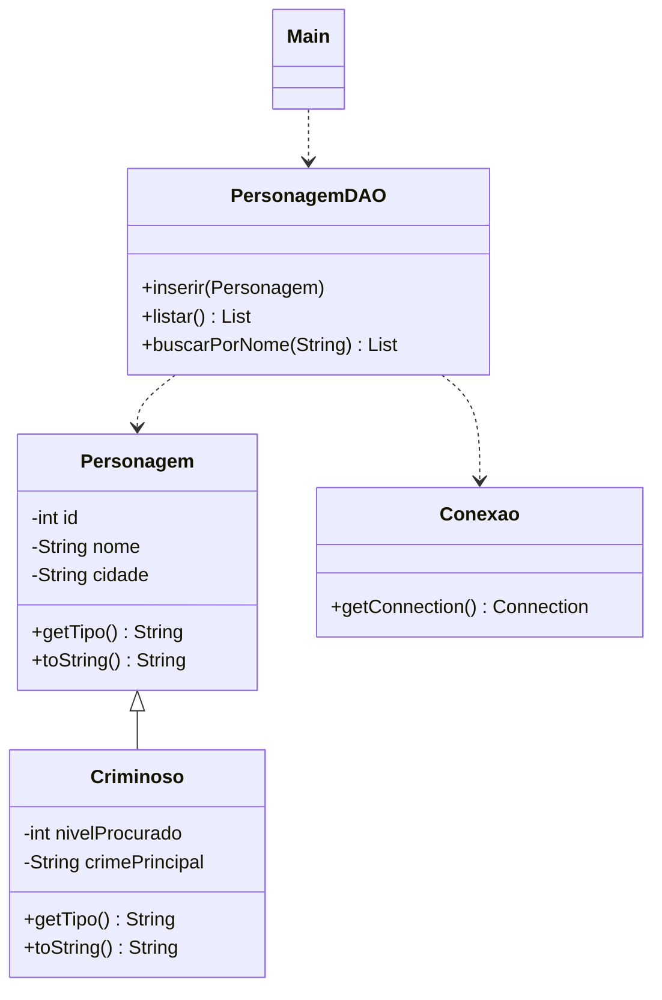

# GTA VI - Registro de Personagens

Mini projeto em Java (CLI + MySQL via JDBC) para cadastrar, listar e buscar
personagens do universo de GTA VI (Leonida / Vice City).

## Funcionalidades
- Cadastro de personagem e de criminoso (subclasse)
- Listagem de todos os registros
- Busca por nome

## Tecnologias
Java 17 · Maven · MySQL 8 · JDBC

## Diagrama de classes (versão final)



Versão em Mermaid:



## Banco de dados
Execute o `script.sql` no MySQL. Ele cria o banco `gta6`, a tabela
`personagem` (tabela única com coluna `tipo`) e insere dados de exemplo.

Se necessário, ajuste usuário e senha em `Conexao.java`.

## Como rodar
```bash
git clone <url-do-repo>
cd gta6-mini
mvn compile exec:java -Dexec.mainClass=gta6.Main
```
(ou abra no IntelliJ/Eclipse e rode a classe `Main`)

## Autor
Enzo Valim - SPTech
